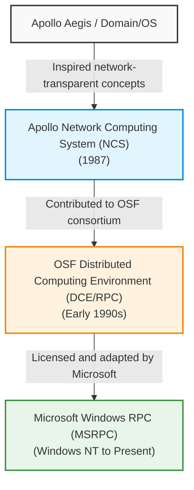

# The Lineage of Microsoft Windows RPC (MSRPC)

**Apollo Computer's distributed technology is a direct ancestor of Windows RPC.** However, the specific lineage flows through Apollo's **Network Computing System (NCS)** and the **Open Software Foundation's DCE/RPC**, rather than its Aegis operating system directly. 

---

### The Evolution Pathway

---

### Architectural Milestones

* **Apollo NCS (Network Computing System):** Released by Apollo Computer in 1987 to implement their Network Computing Architecture (NCA). NCS introduced a highly advanced runtime for Remote Procedure Calls (RPC), a Network Interface Definition Language (NIDL), and a dynamic Location Broker.
* **OSF DCE/RPC:** In 1988, Apollo joined IBM, HP, DEC, and others to form the Open Software Foundation (OSF). Apollo contributed NCS as the foundational baseline for what became the industry-standard **Distributed Computing Environment RPC (DCE/RPC)**.
* **Microsoft Windows RPC (MSRPC):** When Microsoft designed Windows NT in the early 1990s, they licensed the DCE 1.1 RPC standard. They hired key engineers with Apollo roots (such as Paul Leach) to build MSRPC. This architecture natively adapted DCE concepts—like the Endpoint Mapper—onto Windows, famously anchoring it to **TCP/UDP Port 135**.
* **Aegis & Domain/OS Role:** Aegis was Apollo’s pioneering object-oriented, distributed operating system (later evolved into Domain/OS). While Aegis pioneered network-transparent file systems and original concepts for Unique Identifiers (UIDs), the formal, layered RPC specification that Microsoft eventually adopted was born from Apollo's subsequent NCS project rather than the core Aegis kernel.
